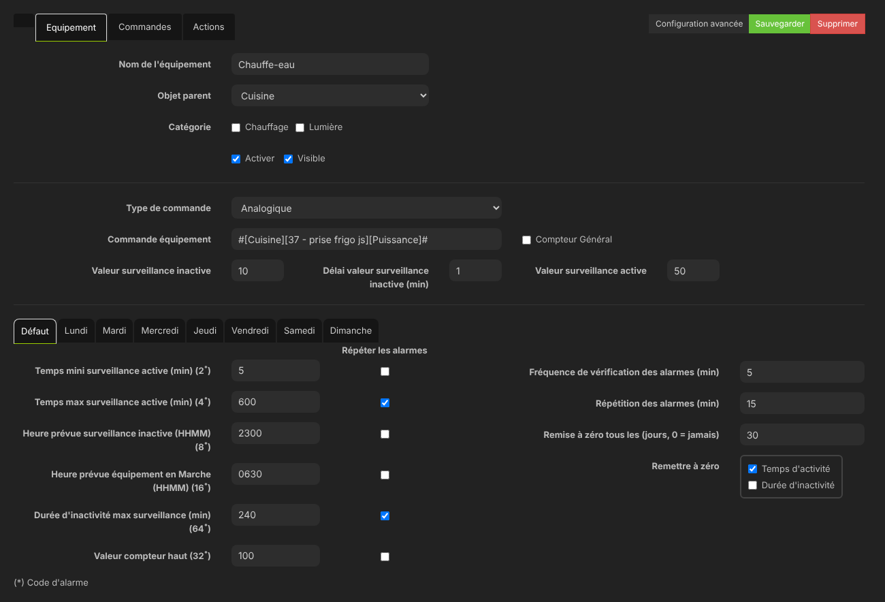
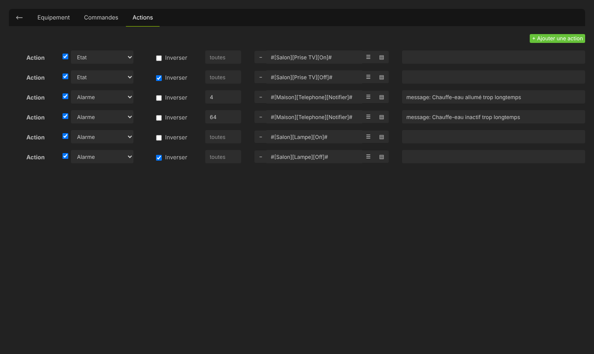

# Plugin surveillancev2 pour Jeedom

Plugin de surveillance d'un équipement (commande logique ou analogique) : temps d'activité, durée d'inactivité, compteur de cycles, alarmes et actions associées.

Compatible Jeedom 4.6.

### Documentation

La documentation complète est [ici](docs/fr_FR/index.md) (historique des versions : [changelog](docs/fr_FR/changelog.md)).

### Prévisualisation

### Fonctions disponibles

Infos :
* Etat, alarme, code d'alarme, heures d'activation et de désactivation, temps de fonctionnement, durée d'inactivité, compteur.

Actions :
* Sur changement d'état ou sur alarme, éventuellement filtrées par numéro d'alarme (cf. la documentation).

Exemple d'utilisation :
* Compter le nombre de cycles d'une machine à laver pour savoir quand lancer un cycle de nettoyage.

## Alarmes (code d'alarme = somme des codes actifs)

| Code | Alarme |
|------|--------|
| 1 | Pas démarré à l'heure prévue + temps mini |
| 2 | Arrêt avant le temps mini de fonctionnement |
| 4 | Temps maxi de fonctionnement dépassé |
| 8 | Arrêt prévu non respecté |
| 16 | Marche prévue non respectée |
| 32 | Compteur haut |
| 64 | Inactivité trop longue (durée d'inactivité max) |

Réglages communs, dans l'équipement :
* **Fréquence de vérification des alarmes** (défaut 5 min).
* **Répétition des alarmes** (défaut 15 min) : une case « Répéter » par alarme, période identique pour toutes.
* **Remise à zéro périodique** des temps d'activité et/ou d'inactivité, tous les N jours.
