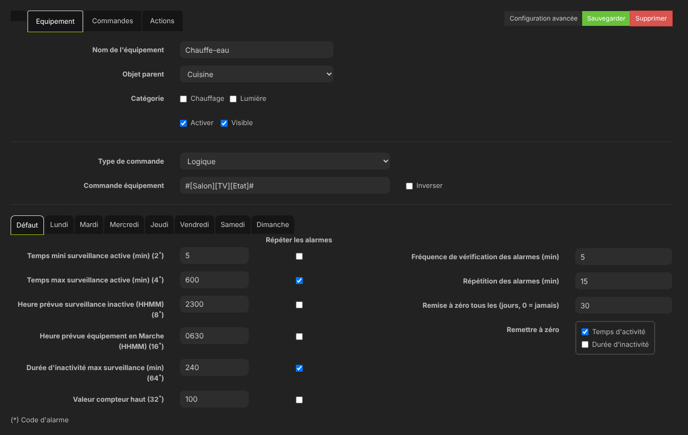
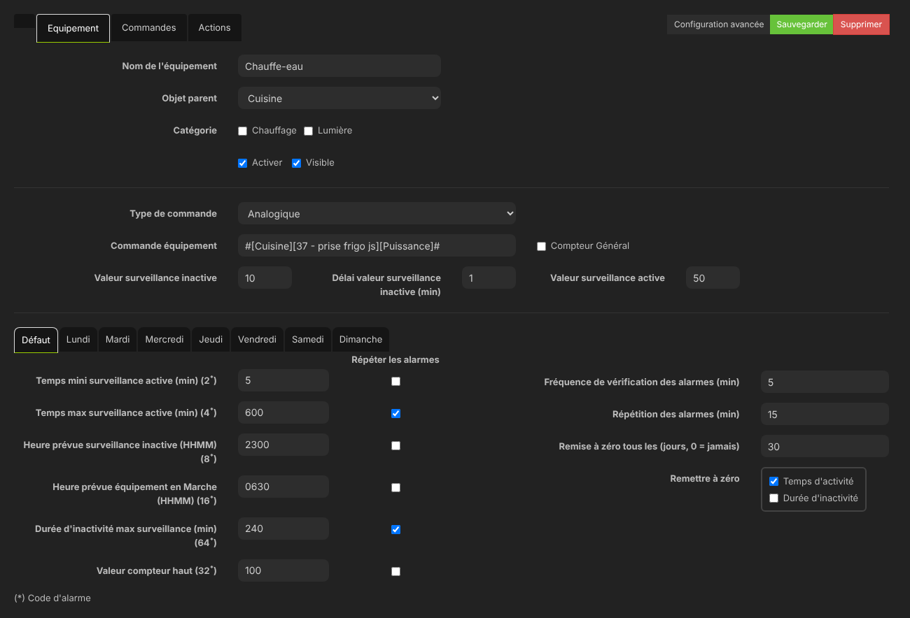
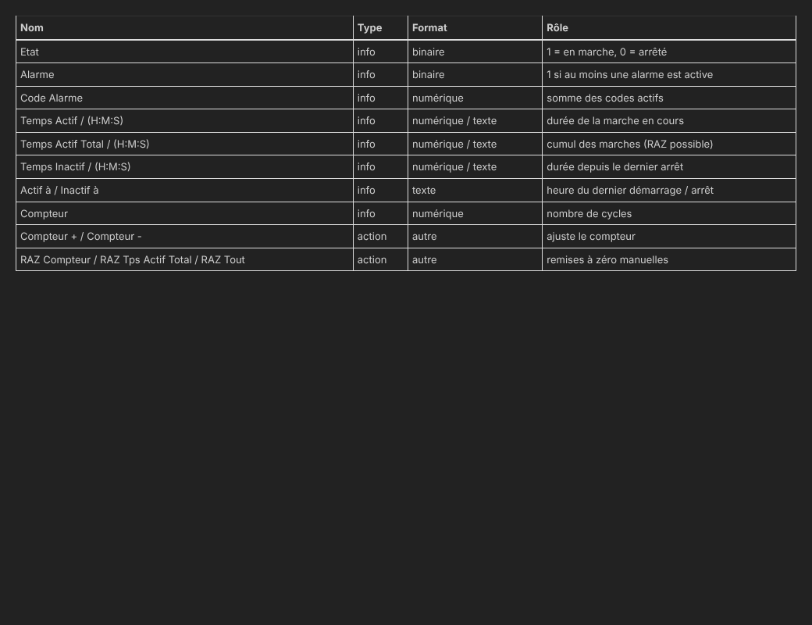
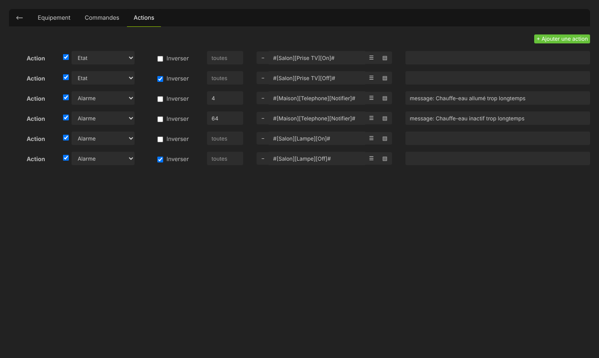
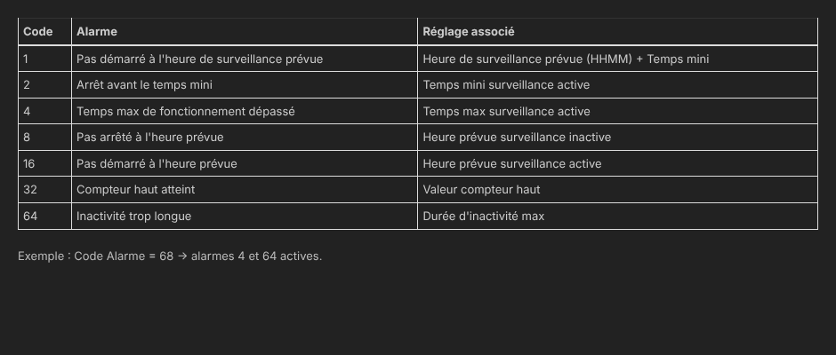
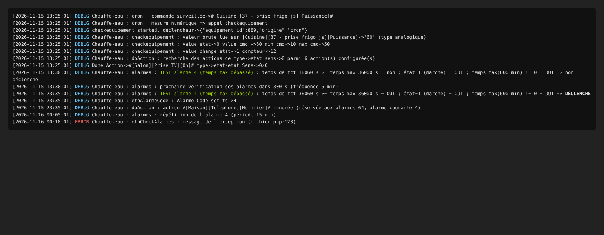

# Plugin Surveillance Equipement V2 (id : surveillancev2)

# Description

Le plugin **Surveillance Equipement V2** surveille un équipement de la maison (télévision, chauffe-eau, lave-linge, congélateur…) à partir d'une commande Jeedom :

- une commande **logique** (état marche / arrêt) ;
- ou une commande **analogique** (puissance, température…), avec des seuils de marche et d'arrêt.

Il calcule le **temps d'activité**, la **durée d'inactivité** et le **nombre de cycles**, déclenche des **alarmes** (7 types, repérés par un code) et exécute des **actions** (allumer une lampe, envoyer une notification…) selon l'état ou l'alarme.

Cette version est la reprise du plugin *Surveillance Equipement* (ethalsurveillance) pour **Jeedom 4.4 et supérieur (PHP 8)**. Elle ajoute notamment :

- l'alarme d'**inactivité trop longue** (code 64) ;
- une **fréquence de vérification** commune à toutes les alarmes ;
- la **répétition** de chaque alarme au choix ;
- des actions **filtrées par numéro d'alarme** ;
- la **remise à zéro périodique** des temps d'activité et d'inactivité ;
- des **logs détaillés** pour comprendre chaque décision du plugin.

> **Important** — lors de l'installation depuis un fichier zip, l'**ID logique du plugin doit être exactement `surveillancev2`** (sinon Jeedom affiche « Plugin introuvable »). Après une mise à jour, faites **Ctrl+F5** pour recharger l'interface.

# Configuration

Après installation, activez le plugin puis rendez-vous dans **Plugins → Monitoring → Surveillance Equipement V2**. La page propose les boutons **Ajouter**, **Configuration** (page de configuration du plugin) et **Logs** (ouvre directement le log `surveillancev2`).

Chaque équipement possède trois onglets : **Equipement**, **Commandes** et **Actions**.

## Onglet Equipement

### Partie haute : l'équipement et la commande surveillée

| Champ | Rôle |
|---|---|
| Nom de l'équipement, Objet parent, Catégorie, Activer, Visible | Réglages Jeedom habituels. |
| Type de commande | **Logique** (état 0/1) ou **Analogique** (valeur numérique). |
| Commande équipement | Commande info à surveiller. Le bouton à droite ouvre le sélecteur de commandes ; on peut aussi saisir directement `#id#`. |
| Inverser (logique) | Inverse le sens de la commande (0 = en marche). |
| Compteur Général (analogique) | Pour une mesure cumulée (compteur général) : voir le log pour le détail du traitement. |
| Valeur surveillance inactive (analogique) | Seuil bas : à cette valeur ou en dessous, l'équipement est considéré à l'arrêt. |
| Délai valeur surveillance inactive (min) | La valeur doit rester sous le seuil bas pendant ce délai avant de passer à l'arrêt (évite les faux arrêts, par exemple un cycle de compresseur). |
| Valeur surveillance active (analogique) | Seuil haut : à cette valeur ou au-dessus, l'équipement est considéré en marche. |

**Équipement logique**



**Équipement analogique**



### Partie basse : les alarmes par jour

Les onglets **Défaut, Lundi … Dimanche** contiennent les réglages des alarmes. Un jour **vide** utilise la valeur de l'onglet **Défaut** ; il suffit donc de renseigner un jour pour lui donner un comportement particulier.

| Champ | Alarme (code) |
|---|---|
| Temps mini surveillance active (min) | **2** : l'équipement s'arrête avant ce temps de fonctionnement. Sert aussi à l'alarme **1** (pas démarré à l'heure prévue + temps mini). |
| Temps max surveillance active (min) | **4** : le temps de fonctionnement dépasse ce temps. |
| Durée d'inactivité max surveillance (min) | **64** : l'équipement est arrêté depuis plus longtemps que cette durée. |
| Heure prévue surveillance inactive (HHMM) | **8** : l'équipement n'est pas arrêté à l'heure prévue. |
| Heure prévue équipement en Marche (HHMM) | **16** : l'équipement n'est pas démarré à l'heure prévue. |
| Valeur compteur haut | **32** : le compteur de cycles atteint cette valeur. |

Une valeur **0 ou vide désactive** l'alarme concernée.

Dans l'onglet **Défaut**, une colonne **Répéter les alarmes** propose une **case par alarme** (sur la ligne de son champ) : **cochée**, les actions de l'alarme sont relancées à chaque période tant qu'elle est active ; **décochée**, elles ne s'exécutent qu'une fois. Ce réglage vaut pour tous les jours. L'alarme 1 a sa propre case à côté du champ « Heure de surveillance prévue » (mode Compteur Général).

### Colonne de droite : paramètres communs aux alarmes

| Champ | Rôle |
|---|---|
| Fréquence de vérification des alarmes (min) | Fréquence à laquelle les alarmes (1, 4, 8, 16 et 64) sont évaluées. Défaut : 5 min. Une alarme peut donc arriver jusqu'à cette durée après son seuil. |
| Répétition des alarmes (min) | Période de répétition, **identique pour toutes les alarmes** (les cases « Répéter » se trouvent dans l'onglet Défaut). Défaut : 15 min. |
| Remise à zéro tous les (jours, 0 = jamais) | Période de la remise à zéro automatique. |
| Remettre à zéro | Cases **Temps d'activité** et **Durée d'inactivité** : choisissent ce qui est remis à zéro. |

## Onglet Commandes

Le plugin crée automatiquement les commandes suivantes :



Les commandes **info** peuvent être utilisées dans les scénarios, les widgets et l'historique ; les commandes **action** (compteur, remises à zéro) peuvent être lancées à la main ou depuis un scénario.

## Onglet Actions

Cet onglet définit ce que fait le plugin lorsque l'état ou l'alarme change.



Chaque ligne comprend, de gauche à droite :

1. **Case Activer** : décochée, l'action est ignorée (le log l'indique).
2. **Type** : **Etat** (changement de marche/arrêt) ou **Alarme**.
3. **Inverser** : l'action s'exécute dans le sens opposé (voir ci-dessous).
4. **Codes d'alarme** (type Alarme uniquement) : liste de numéros (`4`, ou `4,64`). **Vide = toutes les alarmes.**
5. **Commande** à exécuter (boutons de sélection de commande et de mot-clé de scénario).
6. **Options** de la commande (message, titre, curseur…).

| Type | Inverser décoché | Inverser coché |
|---|---|---|
| Etat | l'équipement **passe en marche** | l'équipement **passe à l'arrêt** |
| Alarme | une alarme se **déclenche** | l'alarme **se termine** (remise à zéro) |

Règles pour les actions de type **Alarme** :

- Une action **filtrée** (codes renseignés) s'exécute dès que **l'un de ses codes** devient actif, même si une autre alarme était déjà en cours.
- Une action **sans filtre** s'exécute pour la **première** alarme (passage de « pas d'alarme » à « alarme »), et à chaque répétition.
- À la **fin d'alarme** (Inverser coché), une action filtrée ne s'exécute que si l'un de ses codes était actif.

# Fonctionnement

## Passage de l'état à « en marche »

- La commande **Etat** passe à 1, les commandes **Actif à** et **Compteur** (+1) sont mises à jour et le chronomètre de fonctionnement démarre.
- Si une alarme était active, elle est **remise à zéro** : commandes Alarme et Code Alarme à 0, actions « fin d'alarme » exécutées, décomptes de répétition effacés.
- Le test de l'alarme 32 (compteur haut) est effectué.
- Les actions de type Etat (sens normal) sont exécutées.

## Passage de l'état à « arrêté »

- La commande **Etat** passe à 0, **Inactif à** est mise à jour, le **temps actif** est ajouté au **temps actif total**.
- Les alarmes **2** (arrêt avant le temps mini) et **4** (temps max dépassé) sont testées.
- Les actions de type Etat inversées sont exécutées.

## Vérification périodique des alarmes

Le plugin s'exécute chaque minute. Toutes les **N minutes** (fréquence de vérification) il teste :

1. alarme **1**, **4**, **8**, **16** et **64** ;
2. puis la **répétition** des alarmes actives dont la case « Répéter » est cochée.

Chaque minute, les commandes **Temps Actif**, **Temps Actif Total** et **Temps Inactif** sont aussi mises à jour.

## Codes d'alarme

La commande **Code Alarme** vaut la **somme** des codes actifs (ex. 68 = alarmes 4 et 64). La commande **Alarme** vaut 1 dès qu'au moins un code est actif.



## Répétition des alarmes

Pour chaque alarme dont la case est cochée, tant que son code reste actif, le plugin relance **toutes les actions d'alarme concernées** (filtrées sur ce code, ou sans filtre) à chaque période de « Répétition des alarmes ». La répétition s'arrête quand l'équipement **redémarre** (remise à zéro) ou, pour l'alarme 64, quand la durée d'inactivité est remise à zéro automatiquement.

## Remise à zéro périodique

Si « Remise à zéro tous les » est supérieur à 0 et qu'au moins une case est cochée :

- le **décompte démarre** à la première vérification suivant l'enregistrement ;
- tous les N jours (périodes de 24 h, pas à minuit) :
  - **Temps d'activité** : le temps actif total repart de 0 (si l'équipement tourne, il repart de 0 et continue de croître) ; le temps de la marche en cours n'est pas modifié ;
  - **Durée d'inactivité** : si l'équipement est arrêté, le compteur repart de 0 et le code d'alarme **64** est effacé.

Les commandes « RAZ Tps Actif Total », « RAZ Compteur » et « RAZ Tout » restent disponibles pour une remise à zéro manuelle.

# Cas d'utilisation

## Surveiller la durée de fonctionnement de la télévision

- Type de commande **Logique** sur l'état de la prise ou de la TV.
- **Temps max** : 240 min → alarme 4 si la télévision reste allumée plus de 4 h.
- Action **Alarme**, codes `4`, notification sur téléphone ; cocher **Répéter 4** pour être relancé toutes les 15 min.

## Surveiller son chauffe-eau (mesure de puissance)

- Type **Analogique**, commande de puissance du chauffe-eau.
- **Valeur surveillance inactive** 10 W avec un **délai** de quelques minutes, **valeur active** 50 W.
- **Heure prévue surveillance inactive** (alarme 8) : le chauffe-eau doit être arrêté après les heures creuses.
- **Durée d'inactivité max** (alarme 64) : alerte si le chauffe-eau ne chauffe plus du tout depuis 24 h, avec **Répéter 64** coché.

## Compter les cycles d'un lave-linge

- Type **Analogique** sur la puissance de la prise, **délai** d'arrêt suffisant pour ne pas compter deux cycles lors des pauses.
- La commande **Compteur** donne le nombre de cycles ; **Valeur compteur haut** (alarme 32) prévient quand un lavage de nettoyage est nécessaire ; **RAZ Compteur** après l'entretien.

## Vérifier qu'un congélateur est toujours alimenté

- Surveillez sa prise en **analogique** ; une **durée d'inactivité max** de 12 h déclenche l'alarme 64, répétée toutes les 15 min jusqu'au retour du courant (l'équipement redémarre, l'alarme se termine automatiquement).

# Logs

Le plugin écrit dans le log **surveillancev2** (**Analyse → Logs → surveillancev2**, ou bouton **Logs** de la page du plugin). Pour voir le détail des décisions, passez le niveau de log du plugin en **Debug** (page Configuration du plugin → Logs et surveillance → niveau de log), puis relancez une vérification.



## Structure d'une ligne

`[date heure] NIVEAU  <nom de l'équipement> : <contexte> : <message>`

- **Niveau** : `DEBUG` (fonctionnement normal détaillé), `ERROR` (problème à traiter).
- **Contexte** : d'où vient la ligne (voir ci-dessous).

## Les contextes

| Contexte | Signification |
|---|---|
| `cron` | Passage de la minute : quelle commande est surveillée et si `checkequipement` est appelé directement. |
| `checkequipement started, déclencheur->{…}` | Le plugin se met au travail. `origine:"cron"` = déclenché par le passage de la minute (équipement analogique) ; sinon c'est le **listener** Jeedom qui l'a appelé suite à un changement de valeur de la commande surveillée. |
| `checkequipement` | Analyse de la valeur lue : état précédent, seuils, délai avant arrêt, changement d'état, compteur. |
| `alarmes` | Évaluation périodique des alarmes (fréquence de vérification), tests, répétitions. |
| `doAction` | Choix des actions à exécuter ou ignorées. |
| `ethAlarmeCode` / `ethResetAlarme` | Activation d'un code d'alarme / remise à zéro des alarmes. |
| `ethGetValue` | Lecture des commandes internes (etat, alarme…) ; une valeur « non initialisée » est remise à sa valeur par défaut. |

## Lire un test d'alarme

Chaque alarme testée produit une ligne `TEST …` listant **chaque condition** avec **OUI** ou **non**, puis le résultat :

```
alarmes : TEST alarme 4 (temps max dépassé) : temps de fct 36060 s >= temps max 36000 s = OUI ;
état=1 (marche) = OUI ; temps max(600 min) != 0 = OUI => DÉCLENCHÉ
```

L'alarme n'est déclenchée que si **toutes** les conditions sont à OUI. Il suffit de repérer le « non » pour comprendre pourquoi une alarme ne part pas.

## Lignes utiles à connaître

| Ligne | Explication |
|---|---|
| `prochaine vérification des alarmes dans 300 s (fréquence 5 min)` | Normal : les alarmes ne sont évaluées qu'à la fréquence réglée. |
| `valeur brute lue sur … -> '60' (type analogique)` | Valeur réellement lue sur la commande surveillée. |
| `value etat->0 value cmd ->60 min cmd->10 max cmd->50` | État actuel, valeur lue et seuils : 60 ≥ 50 → passage en marche. |
| `valeur 8 <= seuil arrêt 10 => début du délai avant arrêt (…)` / `délai avant arrêt annulé` | Délai de confirmation avant de déclarer l'arrêt. |
| `ethAlarmeCode : Alarme Code set to->4` | Le code 4 est ajouté au Code Alarme. |
| `doAction : recherche des actions de type->alarme sens->0 parmi 6 action(s)` | Début du choix des actions. |
| `action … ignorée (réservée aux alarmes 64, alarme courante 4)` | Le filtre « Codes d'alarme » de l'action ne correspond pas. |
| `action … ignorée (sans filtre : exécutée seulement à la première alarme)` | Une autre alarme était déjà active. |
| `action … ignorée (case « Activer » décochée)` | L'action est désactivée. |
| `Done Action->… options->{…}` | L'action a été lancée. |
| `répétition de l'alarme 4 (période 15 min)` / `alarme 4 répétée dans 420 s` | Répétition effectuée / temps restant avant la prochaine. |
| `RAZ périodique …` | Remise à zéro automatique (ou initialisation du décompte). |
| `code d'alarme 64 effacé` | Fin de l'alarme 64 après remise à zéro de l'inactivité. |
| `aucune commande surveillée renseignée, listener non créé` | Équipement enregistré sans commande surveillée : renseignez la commande. |

## Erreurs

Toute ligne `ERROR` indique le fichier et la ligne en cause (ex. `ethCheckAlarmes : … (surveillancev2.class.php:123)`). Envoyez-la avec quelques lignes DEBUG précédentes si vous demandez de l'aide.

# FAQ

**Je ne trouve pas mon équipement dans le sélecteur de commande.**
Saisissez directement `#id#` de la commande dans le champ, ou rechargez la page avec Ctrl+F5 puis réessayez.

**« Plugin introuvable : surveillancev2 » après l'envoi du zip.**
L'ID logique saisi lors du chargement du zip doit être exactement `surveillancev2`.

**Mon alarme ne se déclenche jamais.**
Passez le log en debug et cherchez la ligne `TEST alarme N` : la condition à « non » indique la cause (réglage à 0, équipement dans le mauvais état, seuil non atteint…).

**Mon alarme arrive en retard.**
Elle est évaluée à la fréquence de vérification (5 min par défaut) : réduisez-la dans la colonne de droite si nécessaire.

**Comment recevoir un rappel régulier tant que le problème dure ?**
Cochez la case du numéro d'alarme dans la colonne « Répéter les alarmes » de l'onglet Défaut et réglez la période dans « Répétition des alarmes (min) ».

**Comment n'être prévenu que pour certaines alarmes ?**
Dans l'onglet Actions, renseignez le champ « Codes d'alarme » de l'action (ex. `4,64`).

**Comment remettre les compteurs à zéro ?**
Manuellement avec les commandes RAZ, ou automatiquement avec « Remise à zéro tous les (jours) ».

# Changelog

Voir [la liste des modifications](changelog.md).
